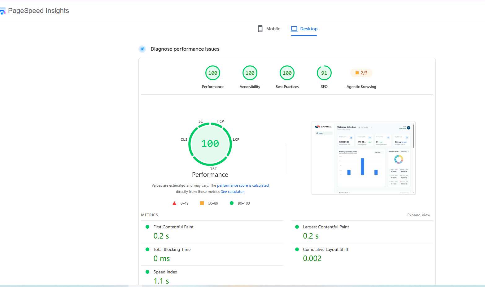
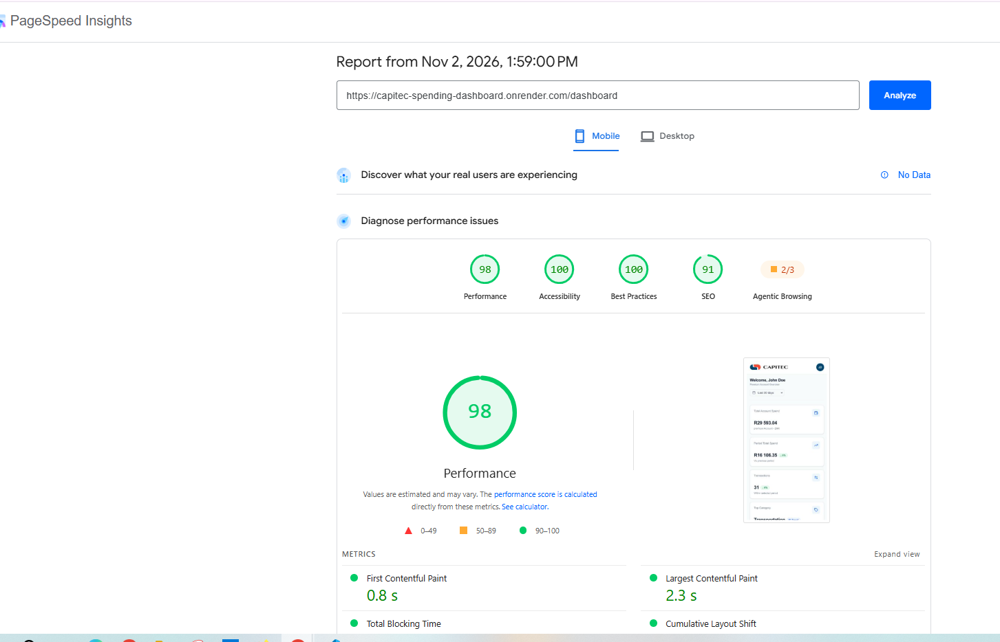

***

# Customer Spending Insights Dashboard

A production-grade, responsive financial analytics dashboard built to display customer spending data.

## Live Demo
[https://capitec-spending-dashboard.onrender.com/dashboard](https://capitec-spending-dashboard.onrender.com/dashboard)

## Tech Stack
* **Framework:** React 19, Vite, TypeScript
* **Styling:** Tailwind CSS, Lucide Icons
* **Data Fetching:** TanStack Query (React Query v5)
* **Charting:** Recharts
* **API Mocking:** Mock Service Worker (MSW)
* **Testing:** Vitest, React Testing Library

---

## How to Run the Project

### Option 1: Using Docker (Recommended)
To build the production image (with mocked API data included for demonstration purposes) and run it:

```bash
# Build the Docker image
docker build -t capitec-dashboard:latest .

# Run the container (accessible at http://localhost:8080)
docker run -d -p 8080:80 --name capitec-dashboard-app capitec-dashboard:latest
```

### Option 2: Local Development (with Mock Data)
If you prefer to run the app locally without Docker:

```bash
# 1. Install dependencies 
npm install

# 2. Start the development server
npm run dev
```
*The app will be available at `http://localhost:5173`.*

### Option 3: Connect to a Live Backend
To run the app pointing to a real backend, create a `.env` file in the root directory and add:
```text
VITE_ENABLE_MOCKS=false
VITE_API_URL=http://your-backend-url.com
```

---

## How to Test

The project includes unit tests covering utility functions, data formatting, and UI component rendering.

```bash
# Run tests once
npm run test

# Run tests with coverage report
npm run test:coverage
```

### Key Interactions to Test
To see the production-grade functionality in action, please try the following in the live app:

1. **Global Date Filtering:** Change the dropdown at the top  (e.g., from "Last 30 days" to "Last year"). Watch how the KPI cards, the Trends chart, and the Donut chart instantly recalculate their data.
2. **URL State Persistence:** Apply a category filter or date range in the Transactions table, then refresh the page. The filters will persist because the state is synced with the URL. You can also copy the URL and open it in a new tab to see it load with the exact same state.
3. **Resilient Widgets:** Notice how the dashboard components load independently. If you simulate a slow network in Chrome DevTools, you will see individual skeleton loaders for each widget, rather than one giant screen spinner.
4. **Pagination & Sorting:** In the Recent Transactions table, try changing the sort order to "Highest Amount" or clicking "Next" to see the server-side pagination mock in action.

---

## Architecture & Key Technical Decisions

I approached this project as a real-world enterprise application, prioritizing maintainability, performance, and type safety.

### 1. Server State Management (TanStack Query)
**Decision:** I chose TanStack Query to manage all backend data fetching instead of using `useEffect` and `useState`.
**Reasoning:** In a financial dashboard, data is highly dynamic. Managing loading states, error states, caching, retries, and background refetching manually leads to massive boilerplate and race conditions. TanStack Query separates **server state** (data owned by the API) from **client state** (UI state). It automatically caches data, deduplicates requests, and ensures the UI stays in sync with the backend. I also utilized its query key factories to ensure precise cache invalidation when global filters change.

### 2. Resilient UI (React Error Boundaries)
**Decision:** I implemented custom Error Boundaries around every individual widget (Metrics, Charts, Transactions) rather than wrapping the whole page.
**Reasoning:** Financial dashboards consume multiple endpoints. If the `/transactions` API fails or returns malformed data, it should not crash the entire page. By isolating widgets with Error Boundaries and fallback UIs, a failure in one chart is contained. The user can still view their spending trends and retry the failed section without losing the rest of the dashboard.

### 3. API Mocking (Mock Service Worker)
Instead of returning static JSON files, I used MSW to build a simulated backend.
* The MSW handlers parse query parameters, filter dates, and dynamically aggregate data (calculating totals, averages, and category percentages).
* This allows for full interaction with the dashboard. Changing global presets (7d, 30d, 1y) and table filters instantly updates the charts and data, accurately simulating a live API.

### 4. State Management (URL as the Source of Truth)
Rather than using `useState` for filters and pagination, I utilized React Router's `useSearchParams`.
* This makes the dashboard state shareable via URL (e.g., `?period=1y&category=Groceries`).
* It ensures that if the user refreshes the page, their filters and current pagination page are preserved.
* TanStack Query is tightly integrated with these URL params via custom query key factories, ensuring perfect cache invalidation when filters change.

### 5. UI Architecture (Container / Widget / UI)
I strictly separated the components into three layers:
* **UI Components (Dumb):** Purely presentational (e.g., `TransactionTable`, `MetricCard`). They take props and emit events, making them highly reusable and easy to test.
* **Widgets (Smart):** Self-contained features (e.g., `MetricsWidget`, `GoalsWidget`). They handle their own data fetching, loading skeletons, and error boundaries.
* **Pages/Layouts:** Handle the global layout, routing, and high-level state.

### 6. Styling & Responsiveness
Built using a Mobile-First approach with Tailwind CSS.
* Fully responsive: The sidebar collapses, KPI cards stack vertically, and the data table becomes horizontally scrollable on small screens.
* Implemented custom Tailwind variants to strip default browser focus outlines from Recharts SVGs, replacing them with accessible, brand-aligned focus rings.

---

## Performance & Accessibility

This project was built with performance and accessibility as first-class citizens. Below are the Google PageSpeed Insights reports from the deployed production build:

### Desktop


### Mobile


**Key optimizations applied:**
*   **Code Splitting (`React.lazy`):** Heavy charting libraries (Recharts) are lazy-loaded only when the charts enter the viewport, drastically reducing the initial JS bundle size.
*   **Zero Layout Shift (CLS):** Built custom Skeleton loaders for the table, charts, and KPIs that perfectly match the final rendered dimensions, preventing cumulative layout shift during data fetching.
*   **Memoization:** Used `React.memo` for table rows and `useMemo` for chart data transformations to prevent unnecessary re-renders.
*   **Accessibility (a11y - WCAG AA):** Passed 100% of Lighthouse accessibility audits. Implemented semantic HTML, explicit `aria-label`s on all form controls, and carefully adjusted color contrast for text and badges.

### Note on Local Development (Chromium Browsers)
If you are running the app locally with `npm run dev` on Chrome or Edge, you may notice that after a few minutes of idleness, mock data requests will fail. 

This is a known Chromium limitation where idle Service Workers are aggressively terminated to save memory. **To resolve this instantly:** Simply refresh the browser tab. *(Note: I have implemented a `MSWKeepAlive` heartbeat component that mitigates this, but if the worker is fully terminated by the OS, a refresh is required. This does not affect Firefox or Safari).*